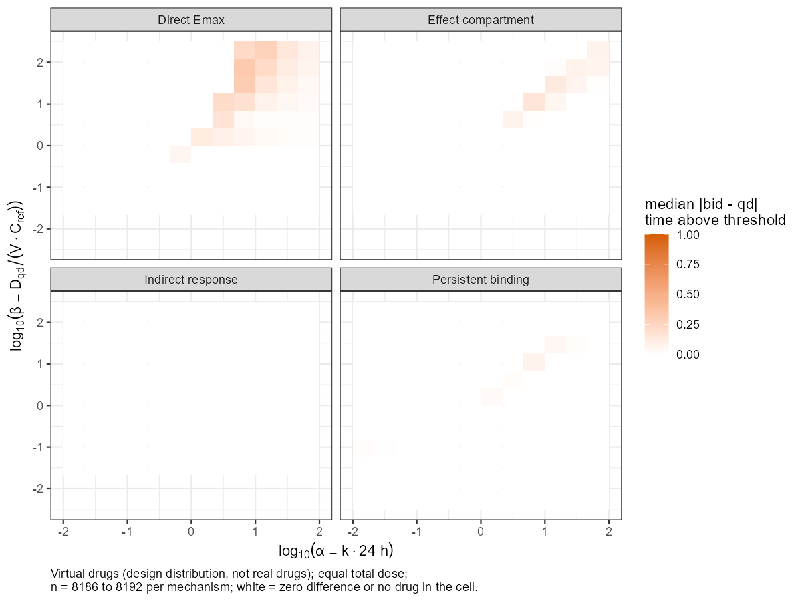
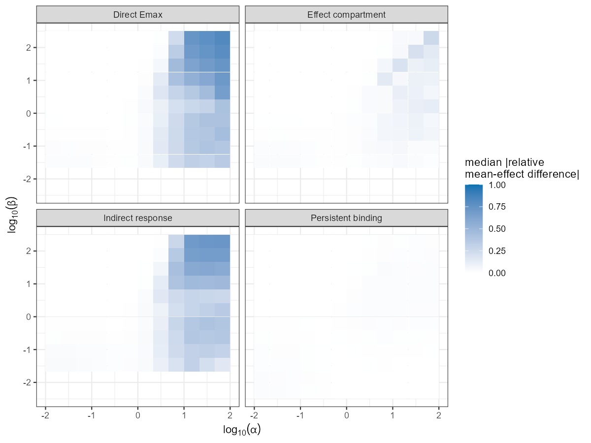

At the same total daily dose, splitting a dose into two halves (twice daily, bid) instead of giving it once daily (qd) changes a pharmacodynamic (PD) proxy mainly when elimination is fast relative to the dosing interval. I define two dimensionless coordinates for a one-compartment drug given by intravenous bolus, derive the steady-state mean effect for a direct Emax relation, and compare qd and bid in 8,192 virtual drugs for each of four PD mechanisms. The mean steady-state effect differed by at least 5% (relative) in 40.4% of direct-Emax drugs, 21.7% of effect-compartment drugs, 40.7% of indirect-response drugs and 7.2% of persistent-binding drugs, almost entirely where the elimination half-life was shorter than about 5.5 h for a 24 h interval. The time above an effect threshold differed by at least 0.10 of the window in 1.9% to 10.3% of virtual drugs. Half-lives of 1,994 real drugs put 44.5% of them in that fast-elimination region, but their PD coordinate is unknown, so the analysis does not say for which real drug frequency matters.

## Introduction

Dosing frequency is often chosen before the shape of the exposure-response relation is known. For a fixed total daily dose, a more frequent schedule lowers the peak-to-trough ratio of concentration. Whether that changes a PD proxy depends on how much concentration varies over the interval, which is set by elimination relative to the interval, and on how nonlinearly the response depends on concentration. The question of interest is: at equal total dose, under which combinations of elimination speed, dose relative to potency and PD mechanism do qd and bid differ in mean effect and in time above an effect threshold, and does a more detailed PD mechanism change where they differ?

The context of use is hypothesis formation in early development: deciding whether a comparison of dosing frequencies, or a PD measurement that could resolve it, is worth planning for a drug whose elimination is known. The influence of this analysis on any decision is low: it is a theoretical map built on virtual drugs, and it does not enter dose selection. A wrong reading would lead to planning an unnecessary frequency comparison or overlooking a necessary one; no patient-level decision follows from it. The results are not dosing recommendations.

## Methods

### Assumptions and definitions

The PK is one-compartment with linear elimination, rate constant $k = CL/V$ (1/h), given by intravenous bolus of dose $D$ (mg) at interval $\tau$ (h). Daily dose is equal: $\tau = 24$ h for qd and $12$ h for bid. The dimensionless coordinates are $\alpha = k\tau$ and $\beta = D/(V\,C_{ref})$, where $C_{ref}$ is EC50 for the Emax-type mechanisms and the dissociation constant $k_{off}/k_{on}$ for persistent binding. For a direct Emax relation with Hill coefficient 1, the steady-state mean effect over one interval, as a fraction of Emax, is

$$\bar{\varepsilon} = \frac{1}{\alpha}\ln\frac{1+\beta/(1-e^{-\alpha})}{1+\beta e^{-\alpha}/(1-e^{-\alpha})}\qquad\text{Equation (1)}$$

with $\alpha$ and $\beta$ taken for the regimen in question (bid has $\alpha/2$ and $\beta/2$). Equation (1) agrees with the closed-form steady state implemented in the companion code to the printed precision (for example 0.4488198 at CL = 2 L/h, V = 20 L, EC50 = 0.5 mg/L, D = 24 mg, $\tau$ = 24 h). The effect is concave in concentration when the Hill coefficient is at most 1, so the regimen with the smaller concentration fluctuation has the larger mean effect; for Hill coefficients above 1 the relation is not concave over the whole range and no sign is implied.

The estimand for each virtual drug is the difference between bid and qd in a PD metric (mean effect, relative to qd; time above threshold, absolute) at equal total dose; results are summarized as shares above fixed thresholds and as medians by coordinate bin. The base model is the direct Emax relation with the closed form of Equation (1); the other three mechanisms are added only to test whether the conclusion about where the schedules differ changes.

### Virtual drugs and simulation

For each of four mechanisms (direct Emax, effect compartment, indirect response of the inhibition-of-production type, and persistent reversible binding) I drew 8,192 virtual drugs with a randomly shifted Sobol design (seed 20261201). The ranges were: $k\cdot 24$ h from 0.01 to 100, reference concentrations from 0.01 to 100 times a reference concentration, Hill coefficient 0.5 to 4, and PD rate constants from 0.01 to 100 per 24 h (the full list is in the configuration file). Volume was fixed at 10 L and the dose rate at 1 mg/h (qd 24 mg, bid 12 mg, for 14 days). Equations were solved numerically (`rxode2`); features were computed over the last 7 days of dosing: mean effect, the fraction of time with effect at or above 0.5 of Emax (time above threshold), Cmax and AUC. These ranges are a stress-test design, not a distribution of real drugs.

### Thresholds and real-drug half-lives

I fixed the thresholds before the analysis: frequency "matters" for the time above threshold if the bid-qd difference is at least 0.10 of the window, and for the mean effect if the relative difference is at least 5%. Values of 0.05, 0.20 and 2%, 10% are reported as sensitivity checks. Real-drug half-lives are geometric means of single-dose half-lives in the NCATS Fast Response Database (FRDB) ([1](#ref-1)): 1,994 drugs with a finite positive half-life, giving $\alpha_{qd} = \ln 2/t_{1/2}\times 24$ h. This reads the terminal phase as one-compartment elimination; after oral dosing the apparent half-life can reflect absorption. No PD coordinate exists for these drugs.

## Results

### Where the two schedules differ

On the grid of $\log_{10}\alpha$ and $\log_{10}\beta$, differences appeared mainly where $\alpha_{qd}$ exceeds about 3 (Figure 1 and Figure 2). Table 1 gives the share of virtual drugs above the pre-set thresholds.

Table 1. Share of virtual drugs for which qd and bid differ at equal total dose.

| Mechanism | n | Time above threshold, difference >= 0.10 | Mean effect, relative difference >= 5% | Either |
| --- | --- | --- | --- | --- |
| Direct Emax | 8,186 | 10.3% | 40.4% | 41.6% |
| Effect compartment | 8,192 | 6.3% | 21.7% | 22.9% |
| Indirect response | 8,191 | 1.9% | 40.7% | 41.0% |
| Persistent binding | 8,192 | 3.2% | 7.2% | 8.3% |

The median relative difference of the mean effect rose with $\alpha_{qd}$ (Table 2). For $\alpha_{qd}\le 1$ it was at most 0.20% in every mechanism. The median absolute difference in time above threshold was zero in every bin except direct Emax at $\alpha_{qd}$ above 3 (0.8 and 1.6 percentage points of the window).

Table 2. Median absolute relative difference of the mean steady-state effect, bid versus qd, by $\alpha_{qd}$ bin.

| $\alpha_{qd}$ | Direct Emax | Effect compartment | Indirect response | Persistent binding |
| --- | --- | --- | --- | --- |
| 0 to 0.1 | 0.05% | 0.07% | 0.20% | 0.12% |
| 0.1 to 0.3 | 0.03% | 0.06% | 0.15% | 0.08% |
| 0.3 to 1 | 0.13% | 0.06% | 0.17% | 0.05% |
| 1 to 3 | 2.4% | 0.47% | 2.2% | 0.22% |
| 3 to 10 | 22.8% | 2.9% | 22.1% | 0.74% |
| above 10 | 55.3% | 7.4% | 46.0% | 0.85% |

Figure 1. Median absolute bid-qd difference in time above threshold on the $\log_{10}\alpha$-$\log_{10}\beta$ grid, by mechanism. Virtual drugs, equal total dose.

Figure 2. Median absolute relative difference of the mean effect on the same grid.

For direct Emax drugs the median relative difference grew with the Hill coefficient (0.81%, 0.94%, 1.4% and 3.3% in the bins 0.5 to 0.8, 0.8 to 1.2, 1.2 to 2 and 2 to 4, pooled over $\alpha$).

### Real-drug elimination coordinates

The 5th, 25th, 50th, 75th and 95th percentiles of $\alpha_{qd}$ across the 1,994 FRDB drugs were 0.26, 1.11, 2.48, 6.54 and 21.2. In the bins of Table 2 the shares were 1.8% (0 to 0.1), 4.1% (0.1 to 0.3), 16.9% (0.3 to 1), 32.7% (1 to 3), 30.0% (3 to 10) and 14.5% (above 10); 44.5% had $\alpha_{qd}$ above 3.

## Discussion

The differences are confined to fast elimination relative to the interval. Where $\alpha_{qd}$ is at most 1 (half-life of about 17 h or longer for a 24 h interval), splitting the daily dose changed the mean effect by at most 0.20% in the median, whichever of the four mechanisms was assumed. In that region the simplest model (direct Emax, Equation (1)) gives the same answer as the three more detailed mechanisms, so adding mechanism does not change the conclusion there. Where elimination is fast, the mechanisms differ: direct and indirect response show large changes in mean effect, the effect compartment shows smaller ones, and persistent binding the smallest. A plausible reading, not tested here, is that the effect compartment and the binding step average concentration over time. The time above threshold changed in a small share of virtual drugs; one possible reason, also untested, is that most drugs sit well above or below the threshold at both schedules, which would make this measure depend strongly on $\beta$.

Half-lives of real drugs lie on both sides of $\alpha_{qd} = 3$, so the elimination coordinate alone does not settle the question; the potency coordinate $\beta$ and the PD mechanism decide. A PD measurement for a specific drug would be needed to place it on the map.

## Limitations

The virtual drugs follow a design distribution, so the shares in Table 1 describe that design and not drug development. The PK is one-compartment with intravenous bolus input; absorption, multi-compartment distribution and nonlinear clearance are not included. Real-drug half-lives are heterogeneous aggregates from different studies, populations and assays. The PD mechanisms are generic proxies not fitted to data, and no external validation of the PD predictions was done. The thresholds were chosen before the analysis but are arbitrary, and Table 1 changes with them (sensitivity values are in `freq-shares.csv` in the companion archive). The results are hypotheses about when PD measurements could be informative, not dosing guidance.

## Conclusion

At equal total dose, qd and bid differ in mean steady-state effect mainly when $k\tau$ exceeds about 3, and the size of the difference depends on the PD mechanism and on dose relative to potency. For slowly eliminated drugs ($k\tau\le 1$) the schedule barely changes the mean effect in this model class. Whether frequency matters for a given real drug needs its PD coordinate, which the data used here do not provide.

This is an independent study of simulated and publicly available data, and it does not represent the views of any organization.

## Data and code availability

Run `workflows/03_generate_space.R` with `workflows/config/frequency.R`, then `workflows/10_frequency_study.R`. The [companion archive](shared/dosing-frequency-dimensionless/dosing-frequency-dimensionless-companion.zip) contains the package source used (version 0.0.5, GPL-3), the two workflow scripts, the configuration files and the result tables (`freq-*.csv`); its README gives the run order. The FRDB files are not redistributed because no redistribution licence was found; they are available from the source in reference ([1](#ref-1)) (retrieved 26 November 2026), and the real-drug part of the analysis is skipped without them. Random seed 20261201; R 4.5.3, rxode2 5.1.8, randtoolbox 2.0.5, ggplot2 4.0.4.

## References {#references}

1. National Center for Advancing Translational Sciences. Fast Response Database [Internet]. NCATS; version 2024-12-30 [cited 2026 Nov 26]. Available from: [https://drugs.ncats.io/downloads-public](https://drugs.ncats.io/downloads-public).
