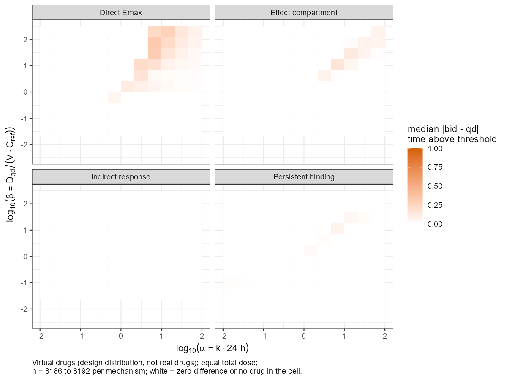
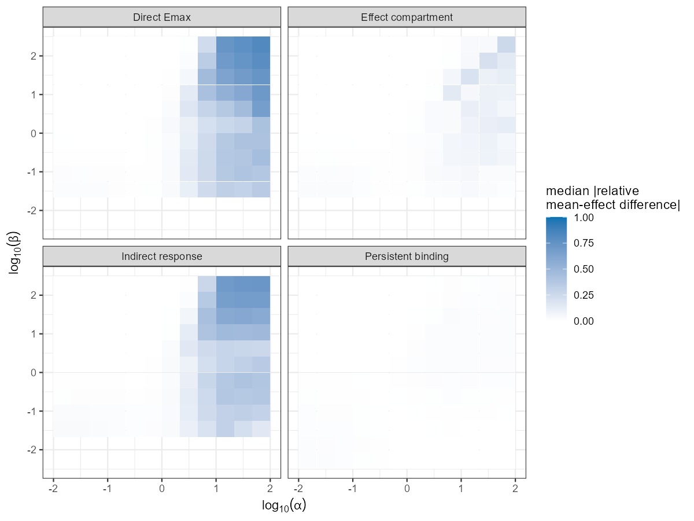

1日の総投与量を同じにしたとき、1日1回(qd)でなく半量ずつ1日2回(bid)に分けると、薬力学(PD)の指標が変わるのは、主に消失が投与間隔に比べて速い場合である。静脈内ボーラスの1コンパートメント薬について2つの無次元座標を定義し、直接Emax関係の定常状態の平均効果を導き、4種類のPD機構それぞれ8,192個の仮想薬でqdとbidを比べた。平均定常効果の相対差が5%以上だった割合は、直接Emaxで40.4%、効果コンパートメントで21.7%、間接反応で40.7%、持続結合で7.2%であり、ほとんどが24時間間隔に対して消失半減期が約5.5時間より短い領域にあった。効果閾値を超える時間の差が窓の0.10以上になった割合は、1.9%から10.3%だった。実薬1,994種の半減期では44.5%がこの速い消失の領域に入るが、PD座標は不明であり、どの実薬で投与頻度が効くかは、この解析からは分からない。

## 背景と目的

投与頻度は、曝露と反応の関係の形が分かる前に決められることが多い。1日の総量を固定すると、頻度を上げるほど濃度の山谷の比は小さくなる。それがPD指標を変えるかどうかは、間隔内で濃度がどれだけ動くか(間隔に対する消失の速さで決まる)と、反応が濃度に対してどれだけ非線形かに依存する。問いは、総投与量が等しいとき、消失の速さ、効力に対する用量、PD機構のどの組合せで、qdとbidが平均効果と効果閾値を超える時間で異なるか、そして詳細なPD機構を加えるとその境界が変わるか、である。

利用の文脈は初期開発での仮説形成である。消失が分かっている薬について、投与頻度の比較、あるいはそれを決着できるPD測定を計画する価値があるかを考える場面を想定する。この解析が意思決定に与える影響は小さい。仮想薬に基づく理論上の地図であり、用量選択には入らない。読み誤った場合の結果は、不要な頻度比較を計画するか、必要な比較を見落とすことであり、患者レベルの判断はこれに続かない。結果は投与量の推奨ではない。

## 方法

### 仮定と定義

PKは線形消失の1コンパートメントで、消失速度定数を $k = CL/V$ (1/h) とし、用量 $D$ (mg) を間隔 $\tau$ (h) で静脈内ボーラス投与する。1日の総量は等しく、qdは $\tau = 24$ h、bidは $\tau = 12$ hとする。無次元座標は $\alpha = k\tau$ と $\beta = D/(V\,C_{ref})$ で、$C_{ref}$ はEmax型の機構ではEC50、持続結合では解離定数 $k_{off}/k_{on}$ とする。Hill係数1の直接Emax関係で、1間隔にわたる定常状態の平均効果(Emaxに対する割合)は次の式になる。

$$\bar{\varepsilon} = \frac{1}{\alpha}\ln\frac{1+\beta/(1-e^{-\alpha})}{1+\beta e^{-\alpha}/(1-e^{-\alpha})}\qquad\text{式 (1)}$$

$\alpha$ と $\beta$ は対象のレジメンについて取る(bidは $\alpha/2$ と $\beta/2$)。式(1)は配布コードに実装した閉形式の定常状態と表示精度まで一致した(例：CL = 2 L/h、V = 20 L、EC50 = 0.5 mg/L、D = 24 mg、$\tau$ = 24 hで0.4488198)。Hill係数が1以下なら効果は濃度に対して上に凸であり、濃度の変動が小さいレジメンほど平均効果が大きい。Hill係数が1を超えると全範囲では凸でなく、符号は定まらない。

仮想薬ごとの推定対象は、総投与量が等しいときのbidとqdのPD指標の差である(平均効果はqdに対する相対差、閾値を超える時間は絶対差)。結果は、固定した閾値を超える割合と、座標区分ごとの中央値でまとめる。基本モデルは式(1)の閉形式を持つ直接Emax関係とし、他の3つの機構は、2つのスケジュールが異なる領域についての結論が変わるかを調べるためだけに加える。

### 仮想薬とシミュレーション

4種類の機構(直接Emax、効果コンパートメント、産生抑制型の間接反応、持続的な可逆結合)それぞれで、ランダムシフトしたSobol設計(シード20261201)により8,192個の仮想薬を生成した。範囲は、$k\cdot 24$ hが0.01から100、基準濃度が基準濃度の0.01倍から100倍、Hill係数が0.5から4、PDの速度定数が24時間あたり0.01から100である(全体は設定ファイル)。体積は10 L、投与速度は1 mg/h(qdは24 mg、bidは12 mg、14日間)に固定した。数値解法(`rxode2`)で解き、投与最後の7日間で平均効果、効果がEmaxの0.5以上である時間の割合(閾値を超える時間)、Cmax、AUCを計算した。この範囲はストレステスト用の設計であり、実薬の分布ではない。

### 閾値と実薬の半減期

閾値は解析前に決めた。閾値を超える時間ではbidとqdの差が窓の0.10以上、平均効果では相対差が5%以上のとき、頻度が効くとみなす。感度確認として0.05、0.20と2%、10%も報告する。実薬の半減期は、NCATS Fast Response Database (FRDB) ([1](#ref-1)) の単回投与の半減期の幾何平均で、有限の正の半減期を持つ1,994薬から $\alpha_{qd} = \ln 2/t_{1/2}\times 24$ h を求めた。終末相を1コンパートメントの消失とみなす読み方であり、経口投与後の見かけの半減期は吸収を反映しうる。これらの薬にはPD座標がない。

## 結果

### 2つのスケジュールが異なる領域

$\log_{10}\alpha$ と $\log_{10}\beta$ の格子上で、差は主に $\alpha_{qd}$ が約3を超える領域に現れた(図1、図2)。表1に、あらかじめ決めた閾値を超えた仮想薬の割合を示す。

表1. 総投与量が等しいときにqdとbidが異なる仮想薬の割合。

| Mechanism | n | Time above threshold, difference >= 0.10 | Mean effect, relative difference >= 5% | Either |
| --- | --- | --- | --- | --- |
| Direct Emax | 8,186 | 10.3% | 40.4% | 41.6% |
| Effect compartment | 8,192 | 6.3% | 21.7% | 22.9% |
| Indirect response | 8,191 | 1.9% | 40.7% | 41.0% |
| Persistent binding | 8,192 | 3.2% | 7.2% | 8.3% |

平均効果の相対差の中央値は $\alpha_{qd}$ とともに増えた(表2)。$\alpha_{qd}\le 1$ ではどの機構でも0.20%以下だった。閾値を超える時間の絶対差の中央値は、$\alpha_{qd}$ が3を超える直接Emax(窓の0.8および1.6パーセントポイント)を除き、すべての区分で0だった。

表2. bidとqdの定常平均効果の相対差の絶対値の中央値($\alpha_{qd}$ の区分別)。

| $\alpha_{qd}$ | Direct Emax | Effect compartment | Indirect response | Persistent binding |
| --- | --- | --- | --- | --- |
| 0 to 0.1 | 0.05% | 0.07% | 0.20% | 0.12% |
| 0.1 to 0.3 | 0.03% | 0.06% | 0.15% | 0.08% |
| 0.3 to 1 | 0.13% | 0.06% | 0.17% | 0.05% |
| 1 to 3 | 2.4% | 0.47% | 2.2% | 0.22% |
| 3 to 10 | 22.8% | 2.9% | 22.1% | 0.74% |
| above 10 | 55.3% | 7.4% | 46.0% | 0.85% |

図1. $\log_{10}\alpha$-$\log_{10}\beta$の格子上での、閾値を超える時間のbidとqdの差の絶対値の中央値(機構別)。仮想薬、総投与量は等しい。

図2. 同じ格子での平均効果の相対差の絶対値の中央値。

直接Emaxでは、相対差の中央値はHill係数とともに増えた($\alpha$ をまとめた値で、Hill係数0.5から0.8、0.8から1.2、1.2から2、2から4の区分で0.81%、0.94%、1.4%、3.3%)。

### 実薬の消失座標

FRDBの1,994薬での $\alpha_{qd}$ の5、25、50、75、95パーセンタイルは0.26、1.11、2.48、6.54、21.2だった。表2の区分では、0から0.1が1.8%、0.1から0.3が4.1%、0.3から1が16.9%、1から3が32.7%、3から10が30.0%、10超が14.5%で、$\alpha_{qd}$ が3を超えるのは44.5%だった。

## 考察

差は、間隔に対して消失が速い領域に限られた。$\alpha_{qd}$ が1以下(24時間間隔で半減期が約17時間以上)では、4つの機構のどれを仮定しても、1日量を分けたことによる平均効果の変化は中央値で0.20%以下だった。この領域では、最も単純なモデル(直接Emax、式(1))が3つの詳細な機構と同じ答えを与えるので、機構を加えても結論は変わらない。消失が速い領域では機構によって差が出る。直接反応と間接反応では平均効果が大きく変わり、効果コンパートメントでは小さく、持続結合では最も小さい。効果コンパートメントと結合の段階が濃度を時間平均する、という読み方は妥当だが、ここでは検証していない。閾値を超える時間が変わった仮想薬は少なかった。ほとんどの薬が両スケジュールで閾値より十分上か下にあるため、この指標が $\beta$ に強く依存するのかもしれないが、これも検証していない。

実薬の半減期は $\alpha_{qd} = 3$ の両側に分布するので、消失座標だけでは問いに答えられない。効力の座標 $\beta$ とPD機構が決める。特定の薬をこの地図に置くには、その薬のPD測定が必要である。

## 限界

仮想薬は設計分布に従うので、表1の割合はその設計を表すもので、創薬の実態ではない。PKは静脈内ボーラスの1コンパートメントで、吸収、多コンパートメント分布、非線形クリアランスは含まない。実薬の半減期は、研究・集団・測定法の異なる集計値の混合である。PD機構は、データに当てはめていない一般的な代理モデルであり、PD予測の外部検証は行っていない。閾値は解析前に決めたが恣意的で、表1はそれによって変わる(感度の値は配布アーカイブの`freq-shares.csv`)。結果は、PD測定がいつ情報を持ちうるかについての仮説であり、投与の指針ではない。

## 結論

総投与量が等しいとき、qdとbidの定常平均効果は主に $k\tau$ が約3を超えるときに異なり、その差の大きさはPD機構と効力に対する用量に依存する。消失が遅い薬($k\tau\le 1$)では、このモデル群の範囲で、スケジュールは平均効果をほとんど変えない。実在の薬で頻度が効くかどうかには、その薬のPD座標が必要であり、ここで使ったデータにはない。

本研究は、シミュレーションと公開データを用いた個人による独立した研究であり、特定の組織の見解を代表しない。

## データとコードの公開状況

実行順：`workflows/03_generate_space.R`と`workflows/config/frequency.R`、続いて`workflows/10_frequency_study.R`。[配布アーカイブ](shared/dosing-frequency-dimensionless/dosing-frequency-dimensionless-companion.zip)に、使用したパッケージのソース(版0.0.5、GPL-3)、2つのスクリプト、設定ファイル、結果表(`freq-*.csv`)を収めた。実行順はアーカイブのREADMEに書いた。FRDBのファイルは再配布許諾が見つからなかったため再配布しない。参照 ([1](#ref-1)) の入手元から取得でき(取得日2026年11月26日)、これらがなければ実薬の部分は実行されずに飛ばされる。乱数シード20261201、R 4.5.3、rxode2 5.1.8、randtoolbox 2.0.5、ggplot2 4.0.4。

## 参照 {#references}

1. National Center for Advancing Translational Sciences. Fast Response Database [Internet]. NCATS; version 2024-12-30 [cited 2026 Nov 26]. Available from: [https://drugs.ncats.io/downloads-public](https://drugs.ncats.io/downloads-public).
