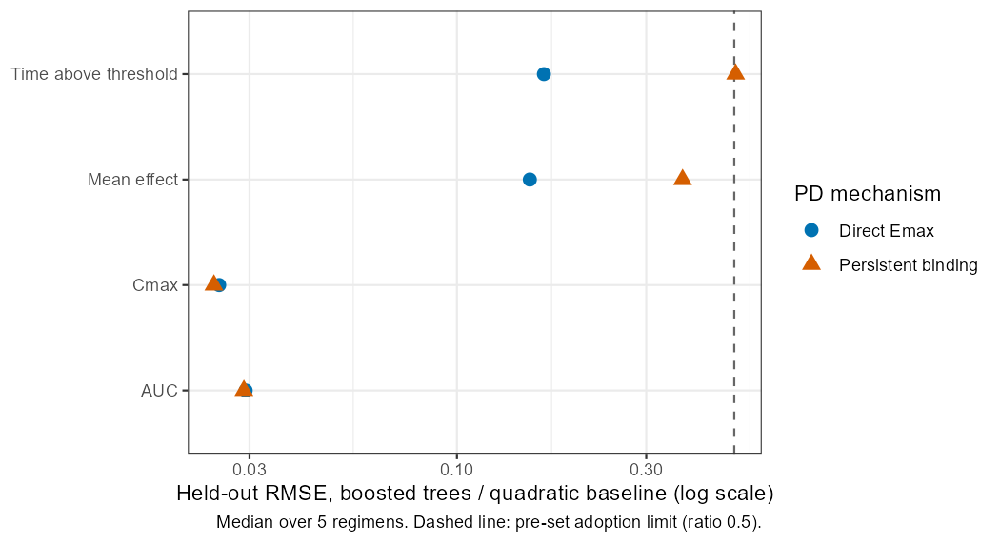

When does a learned approximation of PK/PD simulation outputs deserve to replace the simulation, and when does a simple regression suffice? I trained gradient-boosted trees ([1](#ref-1)) and an interpretable quadratic regression in log-parameters on 16,384 virtual drugs for each of two PD mechanisms (direct Emax and persistent binding) and five dosing regimens, and compared held-out errors for four simulation outputs. The adoption rule was written before the evaluation: boosted trees are adopted for an output only if their held-out RMSE is at most half that of the quadratic regression and they are at least 5 times faster than the simulator. Seven of eight output-mechanism pairs passed, with RMSE ratios from 0.02 to 0.38; time above an effect threshold for persistent binding did not (ratio 0.504). Prediction was about 130 to 170 times faster per row than the simulator. The absolute errors for mean effect and time above threshold stay large, the check for inputs outside the training range is weak, and all results are on synthetic drugs, so the simulator remains the default.

## Introduction

A surrogate for a simulator saves computing time only if its errors do not change what is concluded from the simulated space. Whether to build one for PK/PD simulation outputs depends on how much better a flexible learner is than a simple model that can be read, and on how it behaves where it has no training data. The question of interest is: for AUC, Cmax, mean effect and time above an effect threshold of virtual drugs, does a boosted-tree surrogate improve held-out accuracy over a quadratic regression by at least a factor of two, and is it faster than the simulator by at least a factor of five?

The context of use is the screening of a large virtual drug space for features of regimens, where the simulator is the reference and the surrogate is an optional shortcut. The influence of the surrogate on any decision is low, because a surrogate error mis-ranks virtual drugs and does not touch a patient; the consequence of a wrong adoption is a biased screening summary, which the simulator can recompute. The base model is the interpretable regression; the boosted trees are added only if they pass the pre-set rule.

## Methods

### Virtual drugs, regimens and outputs

For each of two structures (one-compartment intravenous PK with a direct Emax response, and the same PK with persistent reversible binding), I drew 16,384 virtual drugs from a randomly shifted Sobol design (seed 20261127). Ranges were log-uniform: elimination rate times 24 h from 0.01 to 100, for direct Emax, EC50 from 0.01 to 100 times a reference concentration and Hill coefficient 0.5 to 4; for persistent binding, binding rate constants scaled to the same range; the volume was fixed at 10 L. Five regimens delivered 1 mg/h for 14 days: once daily, twice daily, every 48 h, weekly and once daily as a 2 h infusion. Equations were solved numerically with `rxode2`. Outputs were computed over the last 7 days of dosing: AUC and Cmax (log scale), mean effect (log of the value, floored at 10⁻⁶) and the fraction of time with effect at or above 0.5 of Emax, on the logit scale after clipping to 0.001 to 0.999. About 0.26% (direct Emax) and 0.002% (binding) of the rows failed to solve and were excluded.

### Models, splits and the rule

The baseline is a linear regression on standardized log-parameters with squares and all pairwise products. The challenger is gradient-boosted trees ([1](#ref-1)) with fixed settings (300 rounds, depth 4, learning rate 0.1, seed 20261127), not tuned on test data. One model was fitted per structure, regimen and output. Data were split by virtual drug, so a drug's regimens never straddle training and test: 70% of the drugs for training, 30% for testing (about 4,900 drugs), and the drugs in the corner of the design (both of the first two varied parameters above their 90th percentile) that were not already in the test set, about 123 drugs, were withheld from training and evaluated separately as an extra out-of-distribution check. The test set can still contain some corner drugs. The adoption rule, written in the script before evaluation, is: held-out RMSE of the boosted trees at most 0.5 times that of the baseline, and prediction at least 5 times faster per row than the simulator. A bounding box of the training parameters flags inputs outside the training range, and predictions outside it return missing values.

## Results

### Accuracy against the baseline

Table 1 gives the held-out RMSE (median over five regimens) for the null prediction (the training mean), the quadratic regression and the boosted trees.

Table 1. Held-out RMSE of the surrogates by output and PD mechanism (log scale; logit scale for time above threshold).

| Mechanism | Output | Null | Quadratic | Boosted trees | Ratio, boosted / quadratic |
| --- | --- | --- | --- | --- | --- |
| Direct Emax | AUC | 2.05 | 0.264 | 0.0077 | 0.028 |
| Persistent binding | AUC | 2.06 | 0.262 | 0.0076 | 0.028 |
| Direct Emax | Cmax | 1.01 | 0.176 | 0.0044 | 0.022 |
| Persistent binding | Cmax | 1.01 | 0.175 | 0.0043 | 0.021 |
| Direct Emax | Mean effect | 2.47 | 0.782 | 0.119 | 0.165 |
| Persistent binding | Mean effect | 2.41 | 0.319 | 0.118 | 0.377 |
| Direct Emax | Time above threshold | 6.02 | 2.77 | 0.459 | 0.174 |
| Persistent binding | Time above threshold | 6.63 | 3.60 | 1.81 | 0.504 |

Seven of the eight pairs had a ratio of at most 0.5 (Figure 1). Time above threshold for persistent binding, at 0.504, narrowly failed.

Figure 1. Ratio of the held-out RMSE of boosted trees to that of the quadratic regression (median over five regimens; log scale). The dashed line is the pre-set adoption limit.

### Speed

The simulator took 0.78 ms per drug-regimen row for direct Emax and 0.70 ms for persistent binding in the generation run, which includes all features. Predicting one output with the boosted trees took 6.1 and 4.1 microseconds per row, about 130 and 170 times faster. The comparison is not like for like: the simulator returns all features, and each surrogate returns one.

### Outside the training range

For the about 123 withheld corner drugs, 99.1% to 100% were inside the training bounding box, so the check did not flag them. The boosted-tree RMSE on that block was 0.0035 (AUC) and 0.00053 (Cmax) for direct Emax, and 0.0031 and 0.00056 for binding, no larger than in the test set; for mean effect it was 0.243 and 0.185 (against 0.119 and 0.118), and for time above threshold 0.0236 and 1.63 (against 0.459 and 1.81).

## Discussion

For AUC and Cmax, which are smooth functions of the parameters, boosted trees reduced the error by a factor of 35 or more relative to the quadratic regression and gave errors below 1% on the log scale; here the surrogate is plainly useful. For mean effect and time above threshold, which depend on the response nonlinearity and on a threshold crossing, the trees were better than the quadratic baseline by a factor of 2 to 6, but their absolute errors remain large: 0.12 on the log scale for mean effect is about 13%, and 0.46 to 1.81 on the logit scale for time above threshold is a large error in probability terms. The relative rule says nothing about whether an absolute error is acceptable, and I did not set an absolute limit before the evaluation, which is a weakness of the rule.

The bounding box did not flag a withheld corner of the design, because the corner lies inside the box of the training parameters. A check on the box of marginal ranges cannot see a missing region of the joint space. For this reason the surrogate should be used only where the simulation grid is dense, and the simulator remains the default and the fallback.

## Limitations

All results are on synthetic drugs from a design distribution, and a surrogate's accuracy on virtual drugs says nothing about real drugs. Two structures and one regimen panel were studied; the other 14 structures in the package were not. Each surrogate predicts one output for one regimen; I did not evaluate rank agreement between regimens, which is what many screening uses need. The settings of the boosted trees were fixed, not tuned, so the ratios may understate or overstate what a tuned learner would do. The speed comparison depends on the simulator's feature extraction and on a single machine.

## Conclusion

Under the pre-set rule, boosted trees are justified for AUC and Cmax in both mechanisms, and for mean effect in both and for time above threshold in direct Emax (ratios 0.02 to 0.38), but not for time above threshold in persistent binding (0.504); the ratio is relative, and the absolute errors for the nonlinear outputs remain large. The check on the training range is not reliable for missing regions of the design, so the surrogate is an optional shortcut and the simulator stays the reference.

## Data and code availability

The [companion archive](shared/pkpd-simulation-surrogate-adoption/pkpd-simulation-surrogate-adoption-companion.zip) contains the package source (version 0.0.5, GPL-3), the generation script and configuration, the evaluation script and the result tables; the README gives the run order. No third-party data are used. Seed 20261127; R 4.5.3, rxode2 5.1.8, randtoolbox 2.0.5, xgboost 3.2.1.1, ggplot2 4.0.4.

This is an independent study of simulated data, and it does not represent the views of any organization.

## References {#references}

1. Chen T, Guestrin C. XGBoost: a scalable tree boosting system. In: Proceedings of the 22nd ACM SIGKDD International Conference on Knowledge Discovery and Data Mining. 2016:785–794. [doi:10.1145/2939672.2939785](https://doi.org/10.1145/2939672.2939785).
