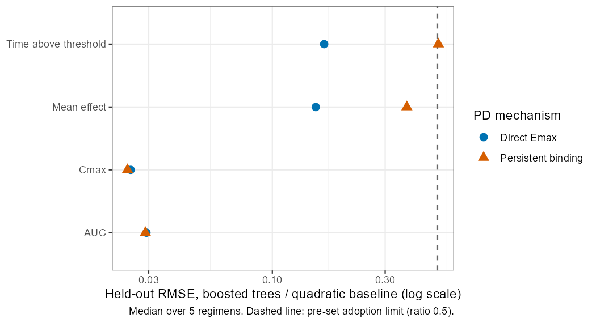

PK/PDシミュレーションの出力を学習で近似したものは、いつシミュレーションの代わりに使う価値があり、いつ単純な回帰で足りるのか。2つのPD機構(直接Emaxと持続結合)それぞれ16,384個の仮想薬と5つの投与レジメンで、勾配ブースティング木 ([1](#ref-1)) と、対数パラメータの解釈できる2次回帰を学習し、4つのシミュレーション出力で保留誤差を比べた。採用規則は評価の前に決めた。ブースティング木は、保留RMSEが2次回帰の半分以下で、シミュレータより5倍以上高速な出力についてだけ採用する。8組の出力と機構のうち7組が通り、RMSEの比は0.02から0.38だった。持続結合の効果閾値を超える時間は通らなかった(比0.504)。予測は1行あたりシミュレータの約130〜170倍速かった。平均効果と閾値を超える時間の絶対誤差は大きいまま残り、学習範囲外の入力の検出は弱く、結果はすべて合成薬のものなので、シミュレータを既定のままにする。

## 背景と目的

シミュレータの代理モデルが計算時間を節約するのは、その誤差が、シミュレートした空間から導く結論を変えない場合だけである。PK/PDの出力に代理モデルを作るかどうかは、柔軟な学習器が、読める単純なモデルよりどれだけ良いかと、学習データがない領域でどう振る舞うかに依存する。問いは、仮想薬のAUC・Cmax・平均効果・効果閾値を超える時間について、ブースティング木の代理モデルは、2次回帰に対して保留精度を2倍以上改善するか、そしてシミュレータより5倍以上速いか、である。

利用の文脈は、大きな仮想薬空間をレジメンの特徴量でスクリーニングする場面で、シミュレータが基準、代理モデルは任意の近道である。代理モデルが意思決定に与える影響は小さい。誤差は仮想薬の順位を誤らせるだけで、患者には届かないためである。誤って採用した場合の結果はスクリーニング要約の偏りであり、シミュレータで再計算できる。基本モデルは解釈できる回帰で、ブースティング木は、事前に決めた規則を通った場合にだけ加える。

## 方法

### 仮想薬とレジメンと出力

2つの構造(静注の1コンパートメントPKと直接Emax応答、同じPKと持続的な可逆結合)それぞれで、ランダムシフトしたSobol設計(シード20261127)から16,384個の仮想薬を引いた。範囲は対数一様で、消失速度×24 hが0.01から100、直接Emaxでは、EC50が基準濃度の0.01倍から100倍、Hill係数が0.5から4、持続結合では結合速度定数を同じ範囲に尺度化し、体積は10 Lに固定した。5つのレジメンは、いずれも14日間1 mg/hを投与する、1日1回、1日2回、48時間ごと、週1回、2時間かけた点滴の1日1回である。数値解法(`rxode2`)で解き、投与最後の7日間で出力を計算した。AUCとCmax(対数)、平均効果(値の対数、下限10⁻⁶)、効果がEmaxの0.5以上である時間の割合(0.001から0.999に切り詰めてロジット)である。解けなかった行は、直接Emaxで約0.26%、結合で約0.002%あり、除いた。

### モデルと分割と規則

ベースラインは、標準化した対数パラメータについて、2乗項とすべての2変数の積を持つ線形回帰である。対抗は勾配ブースティング木 ([1](#ref-1)) で、設定は固定(300ラウンド、深さ4、学習率0.1、シード20261127)とし、テストデータで調整しなかった。構造・レジメン・出力ごとに1つのモデルを当てた。分割は仮想薬単位で、同じ薬の複数のレジメンが学習とテストにまたがらない。薬の70%を学習、30%をテスト(約4,900薬)とし、設計の角(最初の2つの変動パラメータがともに90パーセンタイルを超える)にある薬のうち、すでにテストに入っていないもの(約123薬)は、学習から外して別に評価し、範囲外の追加確認とした。無作為のテスト集合にも、角の薬が一部含まれる。採用規則は、評価の前にスクリプトへ書いた。ブースティング木の保留RMSEがベースラインの0.5倍以下で、予測が1行あたりシミュレータより5倍以上速いこと、である。学習パラメータの外接箱で範囲外の入力を検出し、箱の外では欠測を返す。

## 結果

### ベースラインとの精度比較

表1に、無情報の予測(学習平均)、2次回帰、ブースティング木の保留RMSE(5レジメンの中央値)を示す。

表1. 出力とPD機構ごとの代理モデルの保留RMSE(対数スケール、閾値を超える時間のみロジット)。

| Mechanism | Output | Null | Quadratic | Boosted trees | Ratio, boosted / quadratic |
| --- | --- | --- | --- | --- | --- |
| Direct Emax | AUC | 2.05 | 0.264 | 0.0077 | 0.028 |
| Persistent binding | AUC | 2.06 | 0.262 | 0.0076 | 0.028 |
| Direct Emax | Cmax | 1.01 | 0.176 | 0.0044 | 0.022 |
| Persistent binding | Cmax | 1.01 | 0.175 | 0.0043 | 0.021 |
| Direct Emax | Mean effect | 2.47 | 0.782 | 0.119 | 0.165 |
| Persistent binding | Mean effect | 2.41 | 0.319 | 0.118 | 0.377 |
| Direct Emax | Time above threshold | 6.02 | 2.77 | 0.459 | 0.174 |
| Persistent binding | Time above threshold | 6.63 | 3.60 | 1.81 | 0.504 |

8組のうち7組で比が0.5以下だった(図1)。持続結合の閾値を超える時間は0.504で、わずかに通らなかった。

図1. ブースティング木と2次回帰の保留RMSEの比(5レジメンの中央値、対数軸)。破線は事前に決めた採用限界。

### 速度

生成の実行(すべての特徴量を含む)で、シミュレータは1つの薬とレジメンの行あたり、直接Emaxで0.78 ms、持続結合で0.70 msかかった。ブースティング木で1つの出力を予測するのは、1行あたり6.1マイクロ秒と4.1マイクロ秒で、約130倍と170倍速い。比較は同じ条件ではない。シミュレータはすべての特徴量を返し、各代理モデルは1つを返す。

### 学習範囲の外

外した角の約123薬のうち、学習範囲の外接箱の内側にあったのは99.1%から100%で、検出は働かなかった。この角でのブースティング木のRMSEは、直接EmaxでAUC 0.0035、Cmax 0.00053、結合で0.0031と0.00056で、テスト集合より大きくなかった。平均効果では0.243と0.185(テスト集合は0.119と0.118)、閾値を超える時間では0.0236と1.63(0.459と1.81)だった。

## 考察

パラメータの滑らかな関数であるAUCとCmaxでは、ブースティング木は2次回帰より誤差を35倍以上減らし、対数スケールで1%未満の誤差を与えた。この領域では代理モデルは明らかに有用である。応答の非線形性と閾値の横断に依存する平均効果と閾値を超える時間では、木は2次のベースラインより2倍から6倍良かったが、絶対誤差は大きいままである。平均効果の対数スケールの0.12は約13%に当たり、閾値を超える時間のロジット0.46から1.81は、確率に直すと大きな誤差である。相対的な規則は、絶対誤差が許容できるかについて何も言わず、絶対的な上限を評価の前に決めなかったことは、この規則の弱点である。

外接箱は、設計の外した角を検出しなかった。角は学習パラメータの箱の内側にあるためである。周辺範囲の箱による確認は、同時分布の欠けた領域を見られない。このため代理モデルは、シミュレーションの格子が密な範囲でだけ使うべきで、シミュレータを既定かつ代替として残す。

## 限界

結果はすべて設計分布から引いた合成薬のものであり、仮想薬での代理モデルの精度は、実薬については何も言わない。扱った構造は2つ、レジメンのパネルは1つで、パッケージの他の14構造は扱っていない。各代理モデルは、1つのレジメンについて1つの出力を予測する。多くのスクリーニングで必要になるレジメン間の順位の一致は評価していない。ブースティング木の設定は調整せず固定したので、比は、調整した学習器の性能を過小にも過大にも見積もりうる。速度の比較は、シミュレータの特徴量抽出と1台の計算機に依存する。

## 結論

事前に決めた規則のもとで、ブースティング木はAUCとCmaxでは両機構で、平均効果では両機構で、閾値を超える時間では直接Emaxで正当化される(比0.02から0.38)が、持続結合の閾値を超える時間では正当化されない(0.504)。比は相対的であり、非線形な出力の絶対誤差は大きいままである。学習範囲の確認は設計の欠けた領域には信頼できないので、代理モデルは任意の近道であり、シミュレータが基準のままである。

## データとコードの公開状況

[配布アーカイブ](shared/pkpd-simulation-surrogate-adoption/pkpd-simulation-surrogate-adoption-companion.zip)に、パッケージのソース(版0.0.5、GPL-3)、生成スクリプトと設定、評価スクリプト、結果表を収めた。実行順はREADMEにある。第三者のデータは使っていない。シード20261127、R 4.5.3、rxode2 5.1.8、randtoolbox 2.0.5、xgboost 3.2.1.1、ggplot2 4.0.4。

本研究は、シミュレーションデータを用いた個人による独立した研究であり、特定の組織の見解を代表しない。

## 参照 {#references}

1. Chen T, Guestrin C. XGBoost: a scalable tree boosting system. In: Proceedings of the 22nd ACM SIGKDD International Conference on Knowledge Discovery and Data Mining. 2016:785–794. [doi:10.1145/2939672.2939785](https://doi.org/10.1145/2939672.2939785).
