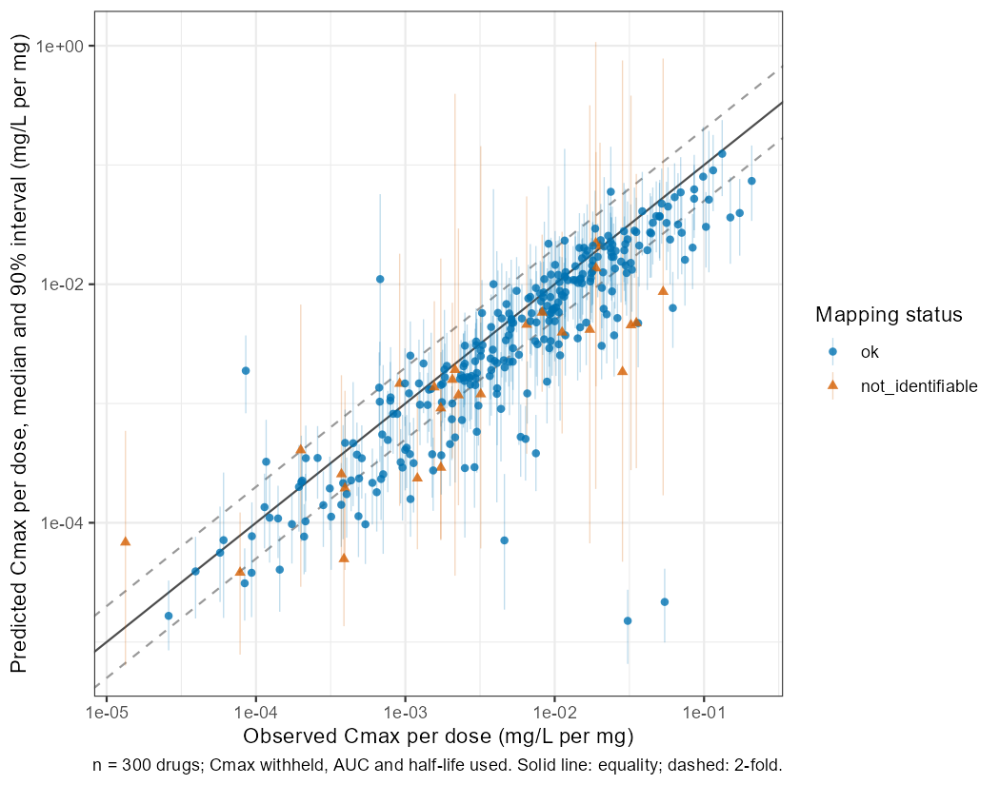
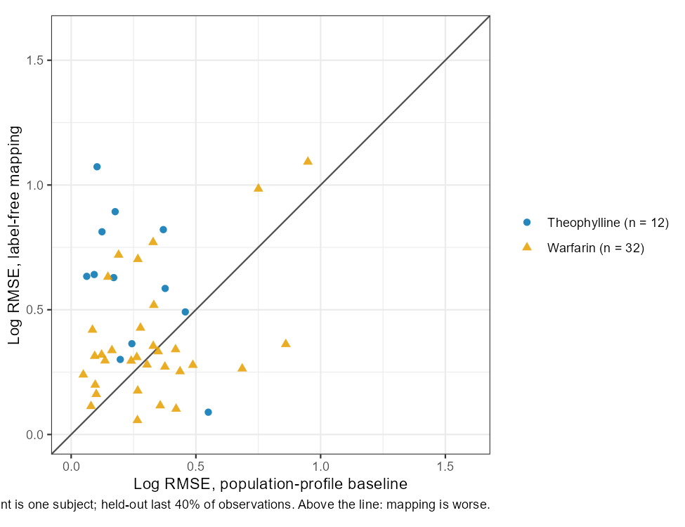

Can the single-dose PK summaries of real drugs be placed on a library of virtual drugs that carries no drug, target or modality label, with an honest statement of what the summaries do not determine? I weighted 100,000 one-compartment virtual candidates by their agreement with the AUC, Cmax and half-life of each drug in the NCATS Fast Response Database (FRDB) ([1](#ref-1)). Of 3,079 drugs, 1,309 were mapped on oral data; 1,567 had too few summaries, 66 lay outside the library and 134 were not identifiable. For 300 drugs, withholding Cmax and predicting it from AUC and half-life gave a log RMSE of 1.11 against 1.85 for a population-median baseline, but the 90% intervals contained only 71.0% of the observed values and the predictions were biased low (median ratio 0.69). On the individual time courses of 12 theophylline and 32 warfarin subjects ([2](#ref-2)), the mapping did not beat a population-profile baseline. After oral dosing only apparent clearance and volume were identified, and on synthetic drugs the posterior intervals were close to calibrated.

## Introduction

A common representation of drug dynamics is useful only if real drugs can be placed in it without the representation being built from them. The library used here is generated without any drug, target or modality information, and real drugs receive weights afterwards. The question of interest is: from the AUC, Cmax and terminal half-life that a public table reports for a drug after a single dose, how well can a label-free one-compartment library predict a quantity that is withheld, and for which drugs should the mapping refuse to answer?

The context of use is to place real-drug exposure summaries on a shared map with stated uncertainty, for comparison with the virtual space. The influence on any decision is low, because the map does not enter dose selection. A wrong placement would misstate how similar two drugs are in exposure; it would not change a dose. The base model is one-compartment with first-order absorption and a population-median baseline; a more detailed model was not tried, because the data per drug are three summary numbers at best.

## Methods

### Data and unit handling

The FRDB table has 13,455 pharmacokinetic rows for 3,079 compounds ([1](#ref-1)). Concentrations, AUC and half-lives were converted to mg/L, mg h/L and h with an explicit unit grammar; units that did not parse were set missing, not guessed. Molar units were converted only when a molecular weight was available. Doses in mg/kg or mg/m² were not converted, and those rows (1,577) were excluded from the mapping. Of all rows, 11,358 had a usable Cmax, 11,054 an AUC, 9,195 a half-life, and 7,798 all three. Thirty-six rows were exact duplicates; 20 half-lives exceeded 1,000 h and 5 Cmax values were not positive. These were flagged, not removed. The mapping used rows for a single oral dose in mg with AUC extrapolated to infinity, and for each drug the geometric mean of the dose-normalized values over its eligible rows. Studies differ in population, formulation and assay, so this mean is a heterogeneous aggregate.

Individual time courses came from the single-dose theophylline data (12 subjects, day 1 of the data distributed with nlme and NONMEM) and the warfarin plasma-concentration data (32 subjects) in the R package nlmixr2data, version 2.0.10 ([2](#ref-2)); the package documentation cites an earlier clinical study as the origin of the warfarin data ([3](#ref-3)), which I did not check against the original paper.

### The label-free library and the weights

The library has 100,000 virtual drugs with clearance CL from 0.01 to 1,000 L/h, volume V from 0.1 to 10,000 L, absorption rate ka from 0.01 to 100 per hour (all log-uniform) and bioavailability F from 0.05 to 1 (logit-uniform), drawn with a randomly shifted Sobol design (seed 20261126). For each candidate, the single-dose AUC per dose, Cmax per dose and terminal half-life follow in closed form from a one-compartment model with first-order absorption; the terminal half-life is $\ln 2/\min(k_a, CL/V)$.

A candidate's weight is proportional to $\exp(-z^2/2)$, where $z^2$ sums the squared standardized log differences between the candidate's summaries and the drug's summaries. The log-scale standard deviation of each summary is $\sqrt{0.25^2 + s^2}$, where $s$ is the between-row standard deviation of that summary for the drug (zero for one row). The 0.25 floor is an assumption fixed before the evaluation. The effective sample size (ESS) is $1/\sum w_i^2$. After oral dosing only $CL/F$ and $V/F$ are identified, so the posterior is reported for these apparent quantities.

A drug is not mapped when the data do not support it: fewer than two available summaries (`insufficient_evidence`); a best-candidate standardized residual above 3 (`out_of_support`); a 5–95% interval of apparent clearance spanning more than a factor of 10 (`not_identifiable`); or an ESS below 30 (`low_effective_sample_size`). All four thresholds were set before the evaluation.

### Evaluation

For the Cmax hold-out, I took the first 300 drugs, in table order, that had all three summaries, withheld the Cmax, and compared the posterior median of Cmax per dose with the observed value. The baseline is the median Cmax per dose of the other 299 drugs. For time courses, the first 60% of each subject's observations (in time order) conditioned the weights, with a log-scale error of 0.3, and the remaining observations were predicted. The baseline for a held-out time is the geometric mean of the dose-normalized concentrations of the other subjects at the nearest observation time, so it uses information from other subjects, whereas the mapping uses only the subject's early points and the library. On 400 synthetic drugs drawn from the library design with a different seed, I checked the coverage and rank uniformity of the 90% intervals with data noise equal to the likelihood standard deviation of 0.10, and compared the posterior median with a direct point regression by boosted trees ([4](#ref-4)) trained on 20,000 library draws.

## Results

### Which drugs could be mapped

Of the 3,079 drugs in the oral mapping, 1,309 were mapped (ESS median 793), 1,567 had fewer than two available summaries, 66 were out of support, 134 not identifiable and 3 had a low ESS. Of the mapped drugs, 57.8% had more than half of their posterior mass on absorption slower than elimination ($k_a < CL/V$); the library's prior mass for this is 34.3%, so the data moved the posterior toward the flip-flop reading, and the half-life of many drugs after oral dosing should not be read as an elimination half-life.

### Withheld Cmax

Table 1 gives the result for the 300 drugs, 274 of which were mapped and 26 not identifiable.

Table 1. Prediction of withheld Cmax per dose from AUC and half-life (log RMSE; fold error; interval coverage).

| Set | n | Log RMSE, mapping | Log RMSE, baseline | Within 2-fold, mapping | Within 2-fold, baseline | 90% interval coverage |
| --- | --- | --- | --- | --- | --- | --- |
| All evaluated | 300 | 1.11 | 1.85 | 63.3% | 29.7% | 71.0% |
| Mapped only | 274 | 1.10 | 1.81 | 65.0% | 31.0% | 69.3% |

A log RMSE of 1.11 corresponds to a typical error of about threefold. The mapping was closer than the baseline for 74.3% of the 300 drugs. The median absolute log error was 0.45 (a factor of 1.57), with quartiles of 0.20 and 0.95, and the median signed log error was −0.37: Cmax was under-predicted by a median factor of 0.69 (Figure 1).

Figure 1. Predicted (posterior median and 90% interval) against observed Cmax per dose for 300 FRDB drugs. Solid line: equality; dashed lines: twofold.

### Individual time courses

Table 2 compares the mapping with the population-profile baseline on held-out observations.

Table 2. Held-out concentrations of individual subjects (log RMSE per subject, median across subjects).

| Data | Subjects | Median observations, held out | Mapping | Baseline | Subjects where mapping is closer | 90% interval coverage |
| --- | --- | --- | --- | --- | --- | --- |
| Theophylline, single dose | 12 | 10, 4 | 0.63 | 0.19 | 1/12 | 100% |
| Warfarin, plasma | 32 | 6, 3 | 0.31 | 0.27 | 12/32 | 100% |

The mapping did not beat the baseline (Figure 2). Pooled over subjects, the log RMSE (root mean square across subjects) was 0.67 against 0.29 for theophylline and 0.45 against 0.39 for warfarin. Every held-out point lay inside the 90% interval, which indicates intervals that are far too wide for six to ten early observations and a library this broad.

Figure 2. Per-subject log RMSE of the label-free mapping against the population-profile baseline. Points above the line: mapping is worse.

### Calibration on synthetic drugs

On 400 synthetic drugs, the 90% intervals contained the true value for 91.5% of apparent clearance, 88.5% of apparent volume, 87.3% of absorption rate and 88.0% of bioavailability. The chi-square statistics of the rank histograms (9 degrees of freedom; 5% critical value 16.9) were 2.95, 4.30, 9.80 and 6.75. Median ESS was 42. The median 90% interval width on the log scale was 0.29 for apparent clearance, 1.98 for apparent volume, 5.99 for absorption rate and 1.84 for bioavailability. The direct regression had similar point errors (log RMSE 0.094, 1.79, 2.19 and 0.62 against 0.086, 1.84, 2.17 and 0.67 for the posterior median, in the same order) but returns no interval; the prior log standard deviations are 3.40, 3.40, 2.66 and 0.71.

## Discussion

For exposure-scale quantities that AUC and half-life constrain, a label-free library can supply a usable prediction of a withheld summary, with a typical error near threefold and an uncertainty that is not yet honest: the intervals are too narrow in the real-drug hold-out (71.0% against a nominal 90%) and too wide for the time courses. These two failures point in opposite directions, so a single inflation or deflation of the error scale would not fix both; the error floor of 0.25 treats between-study variation as independent noise, and the evidence for it is not tested here. The low bias in Cmax may reflect heterogeneous rows or the one-compartment shape; neither explanation was tested.

On the synthetic drugs the intervals were close to calibrated, so the weighting itself is not the source of the real-data miscoverage; model misspecification and aggregation of heterogeneous studies are the candidates. The posterior for absorption rate and bioavailability was nearly as wide as the prior, and a point regression gave a similar error while hiding that width. This is the reason not to replace the weighted candidate set by a regression.

For the time courses, the comparison is not like for like: the baseline uses the other subjects' data and the mapping does not. The result says that, for six to ten early points per subject, this library gives no gain over knowing the population profile; it does not say the mapping is poor for a new drug with no population data.

## Limitations

The hold-out uses the first 300 eligible drugs in table order, not a random sample. One value per drug is a geometric mean over studies that differ in population, formulation and assay, and food conditions were not modeled. The library is one-compartment and cannot represent multi-phasic profiles, which may account for part of the 66 out-of-support drugs. Units that did not parse were dropped, and mg/kg doses were excluded, so drugs reported only per kilogram are absent. Intervals are not calibrated on real data, and only two individual-level datasets were used. No pharmacodynamic data were mapped. Nothing here supports a dose.

## Conclusion

Single-dose summaries of real drugs can be placed on a label-free one-compartment library, with about threefold typical error for a withheld Cmax and an explicit refusal for 1,770 of 3,079 drugs (insufficient evidence, out of support, not identifiable or low ESS). The uncertainty is not calibrated on real data, bioavailability is not identified from oral data, and on individual time courses the mapping adds nothing over a population profile.

## Data and code availability

The [companion archive](shared/real-drug-pk-label-free-mapping/real-drug-pk-label-free-mapping-companion.zip) contains the package source (version 0.0.5, GPL-3), the scripts for the mapping evaluation, the synthetic calibration and the figures, and the result tables. The FRDB and nlmixr2data files are not redistributed: no redistribution licence was found for FRDB, and nlmixr2data is available from CRAN under its own licence. Both are needed to rerun the real-data parts, and the archive's README gives the paths. Seeds 20261126 (library, hold-out) and 20261128 (synthetic calibration); R 4.5.3, xgboost 3.2.1.1, ggplot2 4.0.4.

This is an independent study of publicly available data, and it does not represent the views of any organization.

## References {#references}

1. National Center for Advancing Translational Sciences. Fast Response Database [Internet]. NCATS; version 2024-12-30 [cited 2026 Nov 26]. Available from: [https://drugs.ncats.io/downloads-public](https://drugs.ncats.io/downloads-public).

2. Fidler M, Schoemaker R, Baron K, Wendling T, Grasella T, Weil C, et al. nlmixr2data: nonlinear mixed effects models in population PK/PD, data [Software]. Version 2.0.10. [https://CRAN.R-project.org/package=nlmixr2data](https://CRAN.R-project.org/package=nlmixr2data).

3. O'Reilly RA, Aggeler PM, Leong LS. Studies of the coumarin anticoagulant drugs: the pharmacodynamics of warfarin in man. J Clin Invest. 1963;42(10):1542–1551. [doi:10.1172/JCI104839](https://doi.org/10.1172/JCI104839).

4. Chen T, Guestrin C. XGBoost: a scalable tree boosting system. In: Proceedings of the 22nd ACM SIGKDD International Conference on Knowledge Discovery and Data Mining. 2016:785–794. [doi:10.1145/2939672.2939785](https://doi.org/10.1145/2939672.2939785).
