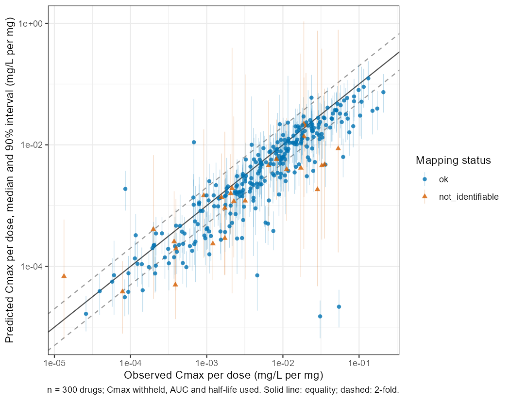
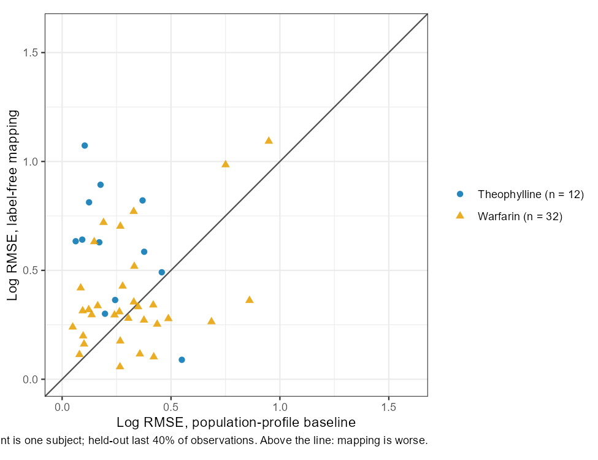

薬剤名・標的・モダリティのラベルを持たない仮想薬のライブラリに、実薬の単回投与PK要約値を置けるか。要約値が決めないことを正直に示したうえで、それができるかを調べた。NCATS Fast Response Database (FRDB) ([1](#ref-1)) の各薬のAUC・Cmax・半減期との一致度で、1コンパートメントの仮想候補10万個に重みを付けた。3,079薬のうち、経口データで対応付けできたのは1,309薬で、1,567薬は要約値が足りず、66薬はライブラリの範囲外、134薬は識別不能だった。300薬でCmaxを伏せてAUCと半減期から予測すると、対数RMSEは集団中央値のベースラインの1.85に対して1.11だったが、90%区間が観測値を含んだのは71.0%にとどまり、予測は低めに偏った(比の中央値0.69)。テオフィリン12名とワルファリン32名の個人時系列 ([2](#ref-2)) では、対応付けは集団プロファイルのベースラインに勝てなかった。経口投与後に同定できたのは見かけのクリアランスと分布容積だけで、合成薬では事後区間はほぼ較正されていた。

## 背景と目的

薬の動態を共通の表現に載せる価値は、その表現が実薬から作られていない場合に出る。ここで使うライブラリは、薬剤・標的・モダリティの情報なしに生成し、実薬には後から重みを付ける。問いは、公開表が単回投与後の薬について報告するAUC・Cmax・終末半減期から、ラベルなしの1コンパートメントのライブラリが、伏せた量をどこまで予測できるか、そしてどの薬では答えを拒否すべきか、である。

利用の文脈は、実薬の曝露要約値を、不確かさを付けて共通の地図に置き、仮想空間と比べることである。この解析が意思決定に与える影響は小さい。地図は用量選択に入らないためである。置き間違えれば、2つの薬の曝露の似かたを誤って述べるが、用量は変わらない。基本モデルは一次吸収つきの1コンパートメントで、ベースラインは集団中央値とした。より詳細なモデルは試していない。1薬あたりのデータが、多くて3つの要約値だからである。

## 方法

### データと単位の扱い

FRDBの表には、3,079化合物の13,455行のPKデータがある ([1](#ref-1))。濃度、AUC、半減期は、明示した単位の文法でmg/L、mg h/L、hに変換し、解釈できない単位は推測せず欠測にした。モル単位は分子量があるときだけ変換した。mg/kgまたはmg/m²の用量は変換せず、その行(1,577行)は対応付けから除いた。全行のうち、Cmaxが使えるのは11,358行、AUCは11,054行、半減期は9,195行、3つ揃うのは7,798行である。完全な重複が36行、1,000 hを超える半減期が20行、正でないCmaxが5行あった。これらは除去せず印を付けた。対応付けには、mg単位の単回経口投与でAUCが無限大まで外挿された行を使い、薬ごとに、適格な行の用量あたりの値の幾何平均を取った。研究ごとに集団・製剤・測定法が異なるため、この平均は異質な集計である。

個人時系列は、Rパッケージnlmixr2data 2.0.10 ([2](#ref-2)) の、テオフィリンの単回投与(12名、nlmeとNONMEMに付属するデータの1日目)とワルファリンの血漿中濃度(32名)を使った。パッケージの文書はワルファリンのデータの原典として過去の臨床研究を挙げている ([3](#ref-3)) が、原著との照合は行っていない。

### ラベルなしライブラリと重み

ライブラリは10万個の仮想薬で、クリアランスCLが0.01から1,000 L/h、分布容積Vが0.1から10,000 L、吸収速度ka が1時間あたり0.01から100(いずれも対数一様)、バイオアベイラビリティFが0.05から1(ロジット一様)である。ランダムシフトしたSobol設計(シード20261126)で生成した。各候補の単回投与のAUC/用量、Cmax/用量、終末半減期は、一次吸収つき1コンパートメントの閉形式で得られ、終末半減期は $\ln 2/\min(k_a, CL/V)$ である。

候補の重みは $\exp(-z^2/2)$ に比例する。$z^2$ は、候補と薬の要約値の対数差を標準化した二乗の和である。各要約値の対数標準偏差は $\sqrt{0.25^2 + s^2}$ で、$s$ はその薬の行間の標準偏差(1行なら0)である。下限0.25は、評価の前に決めた仮定である。有効サンプルサイズ(ESS)は $1/\sum w_i^2$ とした。経口投与後に同定できるのは $CL/F$ と $V/F$ だけなので、事後分布はこれらの見かけの量で報告する。

データが支持しない薬は対応付けしない。要約値が2つ未満(`insufficient_evidence`)、最良候補の標準化残差が3を超える(`out_of_support`)、見かけのクリアランスの5〜95%区間が10倍を超える(`not_identifiable`)、ESSが30未満(`low_effective_sample_size`)である。4つの閾値は評価の前に決めた。

### 評価

Cmaxの保留検証では、3つの要約値が揃う薬のうち表の並び順で最初の300薬を取り、Cmaxを伏せて、Cmax/用量の事後中央値を観測値と比べた。ベースラインは、他の299薬のCmax/用量の中央値である。時系列では、各被験者の観測の最初の60%(時間順)で、対数スケールの誤差0.3として重みを決め、残りを予測した。保留した時点のベースラインは、他の被験者の用量あたり濃度を最も近い観測時間で幾何平均したものであり、他の被験者の情報を使う。対応付けが使うのは、その被験者の初期の点とライブラリだけである。別のシードでライブラリの設計から引いた合成薬400個では、データのノイズを尤度の標準偏差0.10に等しくして、90%区間の被覆率と順位の一様性を調べ、事後中央値を、ライブラリから2万個を引いて学習した勾配ブースティング木 ([4](#ref-4)) による直接の点回帰と比べた。

## 結果

### 対応付けできた薬

経口の対応付けの3,079薬のうち、対応付けできたのは1,309薬(ESS中央値793)で、1,567薬は使える要約値が2つ未満、66薬は範囲外、134薬は識別不能、3薬はESSが低かった。対応付けできた薬の57.8%で、吸収が消失より遅い($k_a < CL/V$)事後確率が半分を超えた。ライブラリの事前確率は34.3%なので、データは事後をフリップフロップの読みへ動かしており、経口投与後の多くの薬の半減期は、消失半減期として読むべきでない。

### 伏せたCmax

表1に300薬(対応付けできた274薬と識別不能の26薬)の結果を示す。

表1. AUCと半減期から、伏せたCmax/用量を予測した結果(対数RMSE、倍数誤差、区間の被覆率)。

| Set | n | Log RMSE, mapping | Log RMSE, baseline | Within 2-fold, mapping | Within 2-fold, baseline | 90% interval coverage |
| --- | --- | --- | --- | --- | --- | --- |
| All evaluated | 300 | 1.11 | 1.85 | 63.3% | 29.7% | 71.0% |
| Mapped only | 274 | 1.10 | 1.81 | 65.0% | 31.0% | 69.3% |

対数RMSE 1.11は、典型的な誤差が約3倍であることに相当する。対応付けがベースラインより近かったのは300薬の74.3%だった。対数誤差の絶対値の中央値は0.45(1.57倍)、四分位は0.20と0.95で、符号つきの対数誤差の中央値は−0.37、つまりCmaxは中央値で0.69倍に過小予測された(図1)。

図1. FRDBの300薬の観測Cmax/用量に対する予測(事後中央値と90%区間)。実線は一致、破線は2倍。

### 個人の時系列

表2に、保留した観測での対応付けと集団プロファイルのベースラインの比較を示す。

表2. 個人の保留した濃度(被験者ごとの対数RMSE、被験者間の中央値)。

| Data | Subjects | Median observations, held out | Mapping | Baseline | Subjects where mapping is closer | 90% interval coverage |
| --- | --- | --- | --- | --- | --- | --- |
| Theophylline, single dose | 12 | 10, 4 | 0.63 | 0.19 | 1/12 | 100% |
| Warfarin, plasma | 32 | 6, 3 | 0.31 | 0.27 | 12/32 | 100% |

対応付けはベースラインに勝てなかった(図2)。被験者をまとめた対数RMSE(被験者間の二乗平均平方根)は、テオフィリンで0.67(ベースライン0.29)、ワルファリンで0.45(0.39)だった。保留した点はすべて90%区間に入っており、初期の6〜10点とこの広いライブラリに対して、区間が広すぎることを示す。

図2. 被験者ごとの対数RMSE(ラベルなしの対応付けと集団プロファイルのベースライン)。線より上は対応付けのほうが悪い。

### 合成薬での較正

合成薬400個で、90%区間が真値を含んだ割合は、見かけのクリアランスで91.5%、見かけの分布容積で88.5%、吸収速度で87.3%、バイオアベイラビリティで88.0%だった。順位ヒストグラムのカイ二乗統計量(自由度9、5%臨界値16.9)は2.95、4.30、9.80、6.75で、ESSの中央値は42だった。対数スケールでの90%区間の幅の中央値は、見かけのクリアランスで0.29、見かけの分布容積で1.98、吸収速度で5.99、バイオアベイラビリティで1.84である。直接の回帰の点の誤差は同程度(同じ順に対数RMSE 0.094、1.79、2.19、0.62、事後中央値は0.086、1.84、2.17、0.67)だが、区間は返さない。事前の対数標準偏差は3.40、3.40、2.66、0.71である。

## 考察

AUCと半減期が制約する曝露の量については、ラベルなしライブラリは伏せた要約値の使える予測を返し、典型的な誤差は3倍近い。ただし不確かさは正直でない。実薬の保留検証では区間が狭すぎ(名目90%に対して71.0%)、時系列では広すぎた。2つの失敗は逆向きなので、誤差の尺度を一律に広げても狭めても両方は直らない。0.25の下限は、研究間のばらつきを独立なノイズとして扱っており、その妥当性はここでは検証していない。Cmaxの低めの偏りは、行の異質性か1コンパートメントの形に由来するかもしれないが、どちらも検証していない。

合成薬では区間がほぼ較正されていたので、重み付けそのものが実データでの被覆不足の原因ではない。候補は、モデルの誤指定と、異質な研究の集計である。吸収速度とバイオアベイラビリティの事後は事前とほぼ同じ幅で、点回帰は同程度の誤差を返しつつその幅を隠した。重み付き候補集合を回帰で置き換えない理由である。

時系列の比較は同じ条件ではない。ベースラインは他の被験者のデータを使い、対応付けは使わない。結果が示すのは、被験者あたり初期の6〜10点では、このライブラリは集団プロファイルを知っている場合に対して利得がない、ということであり、集団のデータがない新薬での対応付けが悪い、ということではない。

## 限界

保留検証は、無作為標本でなく、表の並び順で最初の適格な300薬を使った。薬ごとの1つの値は、集団・製剤・測定法が異なる研究にわたる幾何平均で、食事条件はモデル化していない。ライブラリは1コンパートメントで、多相の動態を表せず、これが範囲外の66薬の一部を説明するかもしれない。解釈できない単位は落とし、mg/kgの用量は除いたので、体重あたりでしか報告されない薬は含まれない。区間は実データで較正されておらず、使った個人レベルのデータは2つだけである。薬力学のデータは対応付けていない。ここから用量を支持できることはない。

## 結論

実薬の単回投与の要約値は、ラベルなしの1コンパートメントのライブラリに置くことができ、伏せたCmaxの典型的な誤差は約3倍で、3,079薬のうち1,770薬では明示的に拒否する(証拠不足、範囲外、識別不能、またはESS不足)。不確かさは実データでは較正されておらず、バイオアベイラビリティは経口データからは同定できず、個人の時系列では、対応付けは集団プロファイルに何も加えなかった。

## データとコードの公開状況

[配布アーカイブ](shared/real-drug-pk-label-free-mapping/real-drug-pk-label-free-mapping-companion.zip)に、パッケージのソース(版0.0.5、GPL-3)、対応付けの評価・合成薬の較正・図のスクリプト、結果表を収めた。FRDBとnlmixr2dataのファイルは再配布しない。FRDBには再配布許諾が見つからず、nlmixr2dataはCRANからそれ自身のライセンスで入手できる。実データの部分を再実行するには両方が必要で、置き場所はアーカイブのREADMEにある。シードは20261126(ライブラリ・保留検証)と20261128(合成薬の較正)、R 4.5.3、xgboost 3.2.1.1、ggplot2 4.0.4。

本研究は、公開データを用いた個人による独立した研究であり、特定の組織の見解を代表しない。

## 参照 {#references}

1. National Center for Advancing Translational Sciences. Fast Response Database [Internet]. NCATS; version 2024-12-30 [cited 2026 Nov 26]. Available from: [https://drugs.ncats.io/downloads-public](https://drugs.ncats.io/downloads-public).

2. Fidler M, Schoemaker R, Baron K, Wendling T, Grasella T, Weil C, et al. nlmixr2data: nonlinear mixed effects models in population PK/PD, data [Software]. Version 2.0.10. [https://CRAN.R-project.org/package=nlmixr2data](https://CRAN.R-project.org/package=nlmixr2data).

3. O'Reilly RA, Aggeler PM, Leong LS. Studies of the coumarin anticoagulant drugs: the pharmacodynamics of warfarin in man. J Clin Invest. 1963;42(10):1542–1551. [doi:10.1172/JCI104839](https://doi.org/10.1172/JCI104839).

4. Chen T, Guestrin C. XGBoost: a scalable tree boosting system. In: Proceedings of the 22nd ACM SIGKDD International Conference on Knowledge Discovery and Data Mining. 2016:785–794. [doi:10.1145/2939672.2939785](https://doi.org/10.1145/2939672.2939785).
